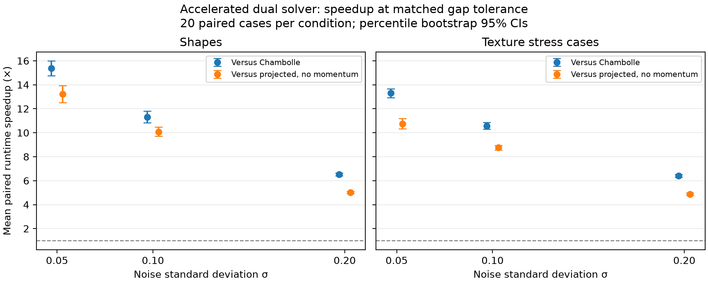
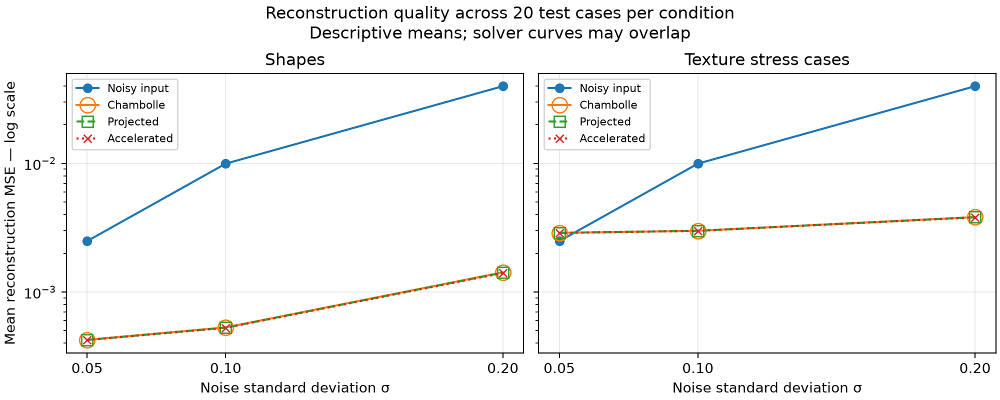
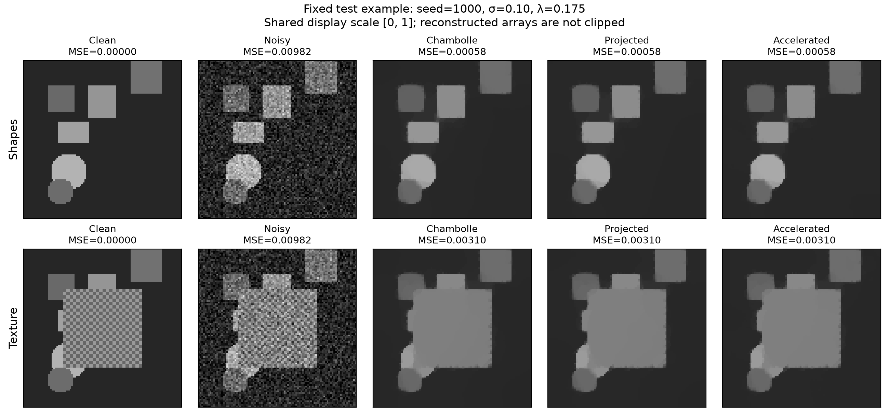

# Total-Variation Image Denoising

EEP55C36 — Computational Methods and Algorithms  
Alexandros Vryonides

## Overview

This project implements Chambolle’s fixed-point algorithm for isotropic
total-variation (TV) image denoising and compares it with an accelerated
projected dual solver.

The research question is:

> Can an accelerated dual solver reach the same optimization accuracy
> faster than Chambolle’s fixed-point method?

The modification changes the numerical solver while preserving the
denoising objective. A projected-gradient solver without momentum
provides an ablation to isolate the contribution of acceleration.

The implementation, verification, validation sweep and final synthetic
experiments are complete.

## Denoising objective

Given a noisy grayscale image `f`, the methods minimize:

```text
0.5 * sum((u - f)^2) + lambda * TV(u)
```

Here `u` is the reconstructed image. Isotropic TV sums the magnitudes
of the vertical and horizontal forward differences at each pixel.

The data term keeps the reconstruction close to the observation.
The TV penalty discourages unnecessary brightness variation while
allowing sharp boundaries.

All methods use matching forward-difference operators, with zero
vertical differences on the final row and zero horizontal differences
on the final column. Divergence is the negative adjoint of the gradient.

The observation model assumes independent additive Gaussian noise.
Noisy observations and reconstructed arrays are not clipped.

## Methods

| Method | Implementation | Description |
|---|---|---|
| Chambolle | `src/baseline.py` | Dual fixed-point iteration with step size 1/8 |
| Projected | `src/modified.py`, `accelerated=False` | Projected dual gradient iteration without momentum |
| Accelerated | `src/modified.py`, `accelerated=True` | Projected dual gradient iteration with FISTA-style momentum |

The accelerated method follows the fast gradient projection approach
of Beck and Teboulle (2009), adapted to this project’s operator convention.
It is an established method, not a claim of a newly invented algorithm.

All three methods optimize the same objective. Acceleration targets
computational efficiency rather than a different image prior.

## Installation

The recorded final experiments used:

- Python 3.14.5
- NumPy 2.5.4
- MacBook Air, 13-inch (2024), Apple M3, 16 GB unified memory
- macOS Tahoe 26.7.1 (`arm64`)

Tested package versions are recorded in `requirements.txt`.
Additional run metadata is stored alongside the final result CSVs.

From the repository directory:

```bash
python3 -m venv .venv
source .venv/bin/activate
python -m pip install -r requirements.txt
```

Windows PowerShell activation:

```powershell
.venv\Scripts\Activate.ps1
```

Run commands from the repository root. Windows has not been independently
verified.

## Quick start

Run the verification checks:

```bash
python -m unittest discover -s tests -v
```

Expected result: 29 passing tests.

Display a baseline example:

```bash
python demo.py
```

This prints noisy and denoised MSE, displays a comparison, and saves
`outputs/baseline_demo.png`. Close the figure window to return to the
terminal.

The original demonstration retains its development settings,
including lambda=0.1 and 200 fixed iterations. The experimental
configurations use the validation-selected lambda and gap stopping.

Run a small comparison:

```bash
python run_experiments.py --config configs/smoke.json
```

Run the textured smoke comparison:

```bash
python run_experiments.py --config configs/stress_smoke.json
```

Each smoke comparison evaluates two seeds, three noise levels and three
methods, producing 18 result rows. On the original machine these runs
take seconds; timings depend on the machine and system load.

Each output directory contains:

- `cases.csv`: quality metrics, iteration counts, convergence status
  and individual timing measurements.
- `metadata.json`: configuration, Git commit, working-tree status
  and software/platform information.

Rerunning a configuration overwrites its output files.

## Data and parameter selection

Images are generated locally from rectangles and disks using the
course mathematical guide. No external image dataset is required.

The texture stress generator replaces the central region with a
checkerboard of intensities 0.4 and 0.6, with squares two pixels wide.

Noise is added as:

```text
noisy = clean + sigma * standard_normal_noise
```

The solver receives only the noisy observation. Clean images are used
for validation scoring and reconstruction evaluation.

| Split | Seeds | Purpose |
|---|---|---|
| Development | Examples and smoke runs used seeds 0 and 1 | Implementation, debugging and protocol checks |
| Validation | 100–109 | Select the shared regularization parameter |
| Final test | 1000–1019 | Independent final comparison |

Validation used three noise levels: 0.05, 0.10 and 0.20.
Candidate lambdas were scored by mean MSE across all 30 validation cases,
with equal weighting.

The initial grid ended at 0.20, which was its best candidate.
The grid was extended before accessing final-test results.

The expanded grid selected:

```text
lambda = 0.175
mean validation MSE = 0.00078304
```

Validation reconstructions used the accelerated solver with a tighter
normalized-gap tolerance of 1e-5. Every validation solve converged.

One fixed lambda is used across all solvers and noise levels.
It is a compromise across conditions, not a noise-adaptive rule.

Selection code and evidence:

- `select_lambda.py`
- `results/validation/`

## Convergence criterion

The primal objective is compared with a dual lower bound calculated
from a feasible auxiliary vector field.

The normalized primal–dual gap is:

```text
(primal - dual) / max(1, abs(primal), abs(dual))
```

Final settings are:

| Setting | Value |
|---|---:|
| Lambda | 0.175 |
| Normalized-gap tolerance | 0.001 |
| Gap-check interval | 10 iterations |
| Maximum iterations | 20000 |
| Image dimensions | 96 × 96 |

A small gap certifies optimization accuracy for the selected objective.
It does not guarantee preservation of all genuine image details.

The baseline also supports fixed-count runs when no tolerance is supplied.

## Verification

Checks cover:

- Hand-computable gradient, divergence and solver updates.
- The gradient/divergence negative-adjoint identity.
- An exact two-pixel denoising solution.
- Constant images and single-row/single-column boundary cases.
- Mean preservation, finite outputs, shapes and input preservation.
- Projection feasibility and idempotence.
- Gap calculations, successful stopping and iteration-cap behaviour.
- Synthetic-data reproducibility and preservation of the noise realization.
- Known MSE and PSNR values.

Passing these checks supports implementation correctness; it does not
establish that the image model suits every application.

## Final experiment protocol

Each image type uses 20 seeds at three noise levels.
Every case is supplied unchanged to all three methods.

This gives:

- 60 cases per image type.
- 180 method-case rows per image type.
- 360 method-case rows across shapes and texture experiments.

Runtime is measured with `perf_counter`. Each method receives one full
warm-up per case, followed by three timed runs. Method order rotates
between repetitions. The median runtime is used for the case-level
comparison, and individual timing samples are retained.

Timing includes solver initialization, iterations and convergence
diagnostics. Data generation, quality metrics and file writing are excluded.

All 360 final method-case combinations reached tolerance.

Timing repetitions are not independent image cases. Comparisons pair
methods by seed within each image-type/noise condition. Related conditions
reuse seeds and should not be pooled as independent observations.

## Results

### Runtime improvement



The figure reports the mean of case-level runtime ratios:

```text
reference runtime / accelerated runtime
```

Values above one favour acceleration. Error bars are percentile bootstrap
95% confidence intervals from 10000 resamples of the 20 paired seed cases
within each condition, using analysis seed 2026.

| Image type | Noise sigma | Mean speedup over Chambolle | Bootstrap 95% CI |
|---|---:|---:|---:|
| Shapes | 0.05 | 15.38× | 14.75–15.98× |
| Shapes | 0.10 | 11.30× | 10.82–11.79× |
| Shapes | 0.20 | 6.53× | 6.41–6.65× |
| Texture | 0.05 | 13.32× | 12.94–13.67× |
| Texture | 0.10 | 10.57× | 10.29–10.86× |
| Texture | 0.20 | 6.41× | 6.29–6.53× |

Acceleration also outperformed the no-momentum projected method on average
in every condition, with mean paired speedups of approximately 4.88–13.22×.

These intervals describe case variation on the tested machine.
They do not quantify variation across hardware or independent timing sessions.

### Reconstruction quality



MSE is averaged across 20 cases per condition; lower is better.
The logarithmic axis accommodates the different error magnitudes.
These are descriptive means, without confidence intervals in this figure.

The three solver curves nearly overlap because they optimize the same
objective to similar accuracy. Distinct markers reveal the overlapping
curves. Small numerical quality differences should not be interpreted
as an improved denoising model.

### Representative reconstruction and stress case



The example uses seed 1000, sigma=0.10 and lambda=0.175.
All panels share display limits [0, 1]; the underlying arrays remain unclipped.

All methods remove much of the noise and retain broad shapes.
They also soften boundaries and erase most of the checkerboard texture.

The stress case demonstrates a model limitation: genuine fine texture
has high TV and can be suppressed alongside noise.

At sigma=0.05, mean whole-image texture MSE increased from approximately
0.0025 in the noisy input to approximately 0.00288 after denoising.
Successful optimization therefore need not improve reconstruction quality.

## Reproduce the experiments and figures

Reproduce parameter selection:

```bash
python select_lambda.py
```

This writes validation outputs to `outputs/validation/`.
The recorded selection evidence is retained in `results/validation/`.

Reproduce the final comparisons:

```bash
python run_experiments.py --config configs/final.json
python run_experiments.py --config configs/stress_final.json
```

These write to `outputs/final/` and `outputs/stress_final/`.
Allow several minutes on a comparable machine; runtime varies.

The analysis scripts read the recorded CSVs under `results/`.
To analyse newly generated runs, copy the matching CSV and metadata pair
from each output directory into its corresponding results directory first.
This replaces the recorded inputs, so preserve the originals if needed.

Analyse the saved results and regenerate figures:

```bash
python analyse_results.py
python plot_results.py
python plot_reconstructions.py
```

Expected outputs:

- `results/paired_summary.csv`
- `results/quality_summary.csv`
- PNG and PDF figures under `results/figures/`

The reconstruction script checks regenerated example MSE against
the recorded CSV values.

Recorded final experiments used clean commit:

```text
e374205d3ba0f34b63ecd81081cfabc211cff5b3
```

This identifies the experiment-producing source, not the eventual
submission tag. Runtime is expected to vary between executions.

## Repository layout

```text
src/
  baseline.py          Chambolle fixed-point solver
  modified.py          Projected and accelerated dual solvers
  operators.py         Gradient and divergence
  diagnostics.py       TV objectives and primal–dual gap
  data.py              Shapes and texture generators
  metrics.py           MSE and PSNR
tests/                 Verification checks
configs/               Smoke and final configurations
results/               Recorded CSVs, metadata and figures
docs/progress.md       Development decisions and corrections
demo.py                Interactive baseline example
select_lambda.py       Validation sweep
run_experiments.py     Paired experiments and timing
analyse_results.py     Paired bootstrap analysis
plot_results.py        Runtime-speedup figure
plot_reconstructions.py  Reconstruction and quality figures
```

## Development history

The project was developed incrementally using feature branches,
meaningful commits and pull requests.

- [Progress log](docs/progress.md): development decisions and milestones.
- [Development review](docs/overall_assessment.md): initial results,
  implementation errors, corrections and interpretation of the final results.

## Limitations

- Evaluation uses small synthetic grayscale images with Gaussian noise.
- Real photographs, other noise models and larger images were not evaluated.
- A single fixed lambda trades off performance across noise levels.
- TV can erase genuine texture and soften boundaries.
- Matched gap tolerances do not imply identical reconstructions or MSE.
- Timing results depend on implementation, hardware and system conditions.
- Confidence intervals are condition-specific and are not simultaneous
  guarantees across all comparisons.

## References

- Chambolle, A. (2004). An Algorithm for Total Variation Minimization
  and Applications. Journal of Mathematical Imaging and Vision,
  20, 89–97.
- Beck, A. and Teboulle, M. (2009). Fast Gradient-Based Algorithms for
  Constrained Total Variation Image Denoising and Deblurring Problems.
  IEEE Transactions on Image Processing, 18(11), 2419–2434.
- EEP55C36 course mathematical guide: operator conventions and
  synthetic-data generation examples.

## Assistance declaration

I used ChatGPT for mathematical explanations, project planning, Git guidance,
debugging, code generation and corrections, verification tests,
experiment and analysis scripts, plotting, and documentation drafts.

I drafted an initial baseline implementation and received an AI-generated
corrected version. The modified solver and substantial supporting code
were also supplied with AI assistance. The course guide supplied the
gradient/divergence implementation and the initial synthetic-data generator.

This declaration records the assistance received. I am responsible for
reviewing the implementation, understanding the submitted work, checking
its correctness and following the module’s academic-integrity requirements.